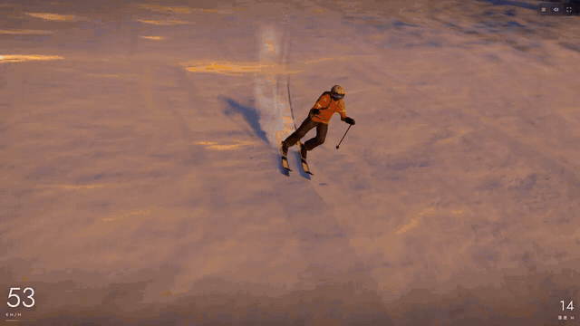
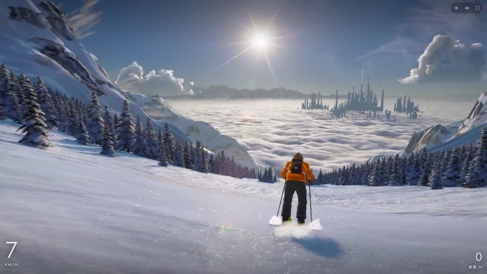
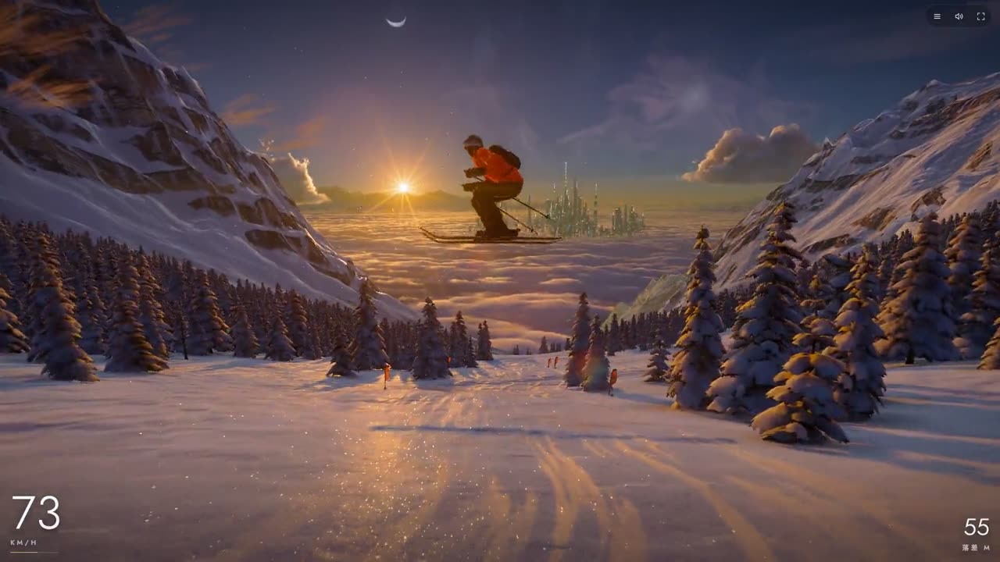
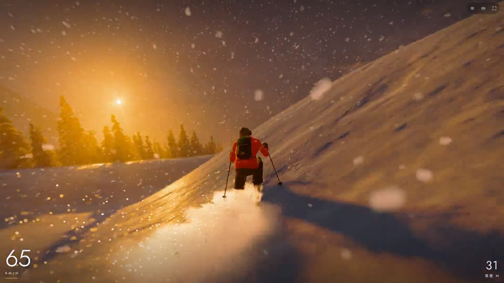
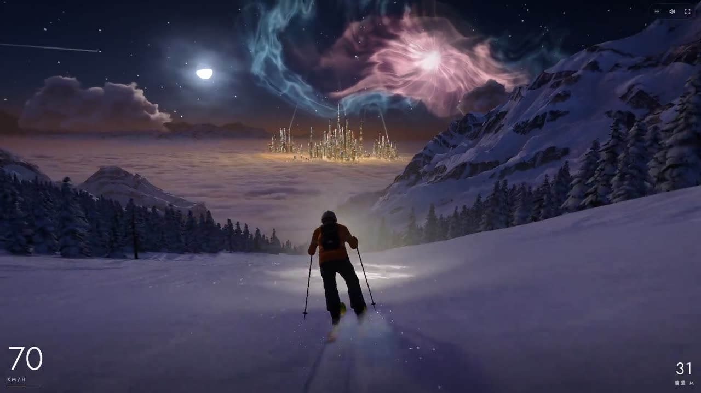

<div align="center">

# 雪迹 · Cold Smoke

**An endless, chill downhill ski game in one HTML file. Every picture and every sound is made by code.**

**一个人，一座山，一直往下滑。整个游戏是一个 HTML 文件，画面和声音全部由代码生成。**

[**▶ Play in your browser / 在线试玩**](https://huisky.xyz/cold-smoke/play) · [English](#english) · [中文](#中文)



</div>

---

## English

Cold Smoke is a calm, endless downhill run through a mountain that never repeats. There is no score to chase and nothing to unlock: you carve, jump, tuck, and watch the light change from morning to night.

What makes it unusual is what the repository **doesn't** contain:

- **No image, audio, model or texture files.** The mountain, snow, trees, sky, clouds, aurora, the skier and the animals, the music and the wind are all generated at runtime by about 18,000 lines of plain JavaScript and shaders.
- **One self-contained page, about 1.6 MB.** The build step just concatenates the source files into `dist/index.html`. No bundler, no framework, no npm dependencies. (The only thing fetched from the network is two web fonts for the title.)
- **WebGPU first, WebGL2 fallback.** Shaders are written once in a WGSL subset and translated to GLSL ES 3.00 for the fallback.
- **Made by talking to an AI.** The game was built with Claude (mostly Claude Fable 5.2) over a few days of play-and-feedback rounds: the author played, described what felt wrong, and Claude rewrote the code.

| | |
|---|---|
|  |  |
|  |  |

### Features

- An endless course built from a shuffled deck of run types: open bowls, steep pitches, woods, ridges, jumps and gates.
- A full day and night cycle with sun, moon, stars, nebula, aurora, a cloud sea and a far city, plus weather from clear skies to heavy snow.
- Snow that reacts: carved tracks, powder plumes and spray lit by the sun, falling snow and wind.
- Synthesised sound and music that follow your speed, turns and time in the air.
- Several camera views, a photo-friendly menu, and English or Chinese UI picked from your browser.
- Every mountain grows from a seed: share the `#seed-…` in the address bar and a friend gets the same mountain.
- Keyboard and mouse on a computer; drag or tilt on a phone held in landscape.

### Controls

| Action | Keyboard | Phone |
|---|---|---|
| Turn | ← → or A D | drag left / right (or tilt) |
| Weight on the tips / tails | ↑ ↓ | drag up / down |
| Jump (hold to load up) | Space | hold the Jump button, let go |
| Tuck for speed | Shift | hold the Tuck button |
| Change camera | V (Shift+V back) | camera button above Jump |
| Menu / pause | Esc | corner button |
| All controls | H | menu |

### Run it locally

You need [Node.js](https://nodejs.org) 18 or newer and a browser with WebGPU or WebGL2 (any recent Chrome, Edge, Safari or Firefox).

```bash
git clone https://github.com/huiskylabs/cold-smoke.git
cd cold-smoke
npm start            # = node build.js && node tools/serve.js
```

Then open <http://localhost:8080>. After editing anything in `src/` or `template.html`, run `node build.js` again and reload.

Useful URL parameters: `?backend=webgl2` (force the fallback renderer), `?lang=en` or `?lang=zh`.

### Project structure

```
src/            the whole game, one module per file, concatenated in name order
  01_gfx.js       rendering layer over WebGPU and WebGL2 (WGSL → GLSL translation)
  03_course.js    the endless mountain
  04_terrain.js   snow and rock        05_sky.js  sun, moon, time of day, aurora
  07_game.js      physics, pose and chase camera
  08_skier.js     the skier, built from distance fields at load
  10_spray.js     snow spray           18_sound.js / 18b_music.js  all audio, synthesised
  19_ui.js        loading page, title, HUD and menus
  ...
template.html   page markup and CSS; build.js puts the code into it
build.js        writes dist/index.html (fragment) and dist/dev.html (full page)
tools/          local server, Xiaohongshu mini-tool build, video frame renderer
director/       camera scripts for recording the trailer (?director=1)
xhs/            polyfills and fonts for the Xiaohongshu mini-tool package
test/           a standalone check of the rendering layer
docs/           architecture notes and the images in this README
```

How each part works, and the look and feel decisions behind it, are in [docs/ARCHITECTURE.md](docs/ARCHITECTURE.md).

### Make your own

If you want to make a game or animation like this with your own AI agent (all code, no assets), see the sibling project [code-only-game-kit](https://github.com/huiskylabs/code-only-game-kit), a skill that teaches an agent how to do it.

### Contributing

Bug reports, performance numbers from real devices and pull requests are welcome. See [CONTRIBUTING.md](CONTRIBUTING.md).

### License

[MIT](LICENSE). The fonts in `xhs/fonts/` (Jost, Cormorant Garamond, Noto Serif SC) are under the SIL Open Font License.

If you like it, a ⭐ helps other people find it.

---

## 中文

雪迹是一个安静的无尽滑雪游戏：一座永远不重复的山，从早滑到晚。没有分数要追，也没有东西要解锁，只管转弯、起跳、压低，看光线一点点变化。

它特别的地方在于仓库里**没有**的东西：

- **没有任何图片、音频、模型或贴图文件。** 雪山、雪、树、天空、云海、极光、滑雪的人和动物、配乐和风声，全部由大约 1.8 万行 JavaScript 和着色器在运行时生成。
- **一个独立的网页，约 1.6 MB。** 构建只是把源文件拼进 `dist/index.html`。没有打包工具，没有框架，没有 npm 依赖（唯一从网上下载的是标题用的两种字体）。
- **优先用 WebGPU，不支持时自动退回 WebGL2。** 着色器只写一遍（WGSL 子集），自动翻译成 GLSL ES 3.00。
- **是跟 AI 聊出来的。** 整个游戏用 Claude（主要是 Claude Fable 5.2）做的，花了几天，一轮一轮地玩、说哪里不对、让 Claude 改代码。

### 有什么

- 无尽的赛道：开阔大坡、陡坡、树林、山脊、跳台、旗门随机组合。
- 完整的昼夜：太阳、月亮、星空、星云、极光、云海和远处的城市，天气从晴天到大雪。
- 会反应的雪：刻滑的雪痕、粉雪扬起的雪雾、逆光的雪花、飘雪和风。
- 合成的音效和配乐，跟着速度、转弯和滞空变化。
- 多个机位，菜单里能换时间和天气拍照，界面中英文按浏览器自动切换。
- 每座山由一个编号生成：把地址栏里的 `#seed-编号` 发给朋友，就是同一座山。
- 电脑用键盘鼠标；手机横屏用拖动或者倾斜。

### 操作

| 动作 | 键盘 | 手机 |
|---|---|---|
| 转弯 | ← → 或 A D | 左右拖动（或倾斜手机） |
| 压板头 / 板尾 | ↑ ↓ | 上下拖动 |
| 跳（按住蓄力） | 空格 | 按住「跳」，松开起跳 |
| 压低加速 | Shift | 按住「加速」 |
| 换机位 | V（Shift+V 往回） | 「跳」上方的机位按钮 |
| 菜单 / 暂停 | Esc | 角上的按钮 |
| 全部操作 | H | 菜单 |

### 在本地运行

需要 [Node.js](https://nodejs.org) 18 以上，和支持 WebGPU 或 WebGL2 的浏览器（最近版本的 Chrome、Edge、Safari、Firefox 都可以）。

```bash
git clone https://github.com/huiskylabs/cold-smoke.git
cd cold-smoke
npm start            # 等于 node build.js && node tools/serve.js
```

然后打开 <http://localhost:8080>。改了 `src/` 或 `template.html` 之后，再跑一次 `node build.js`，刷新页面即可。

常用参数：`?backend=webgl2`（强制用 WebGL2），`?lang=zh` 或 `?lang=en`。

### 小红书小工具

游戏也打包成了小红书的「小工具」（离线网页包）。`node tools/build-xhs.js` 生成 `dist-xhs.zip`，规则和细节见 [docs/ARCHITECTURE.md](docs/ARCHITECTURE.md) 里的「小红书 小工具 package」一节。

### 目录结构

见上面英文部分的 [Project structure](#project-structure)。每个模块怎么工作、画面为什么这样定，写在 [docs/ARCHITECTURE.md](docs/ARCHITECTURE.md)（英文）。

### 自己做一个

想用自己的 AI agent 做一个类似的纯代码游戏或动画（不用任何素材），可以看姊妹项目 [code-only-game-kit](https://github.com/huiskylabs/code-only-game-kit)，它是一个教 agent 怎么做的 skill。

### 参与

欢迎提 bug、贴真机帧率、提 PR，见 [CONTRIBUTING.md](CONTRIBUTING.md)。

### 许可

[MIT](LICENSE)。`xhs/fonts/` 里的字体（Jost、Cormorant Garamond、Noto Serif SC）使用 SIL Open Font License。

喜欢的话点个 ⭐，能让更多人看到。
