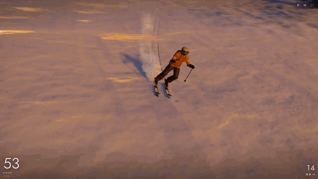
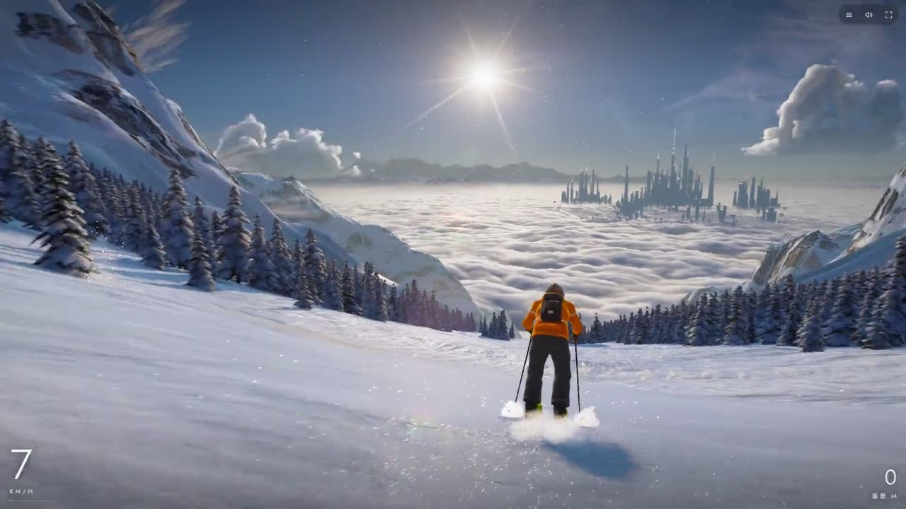
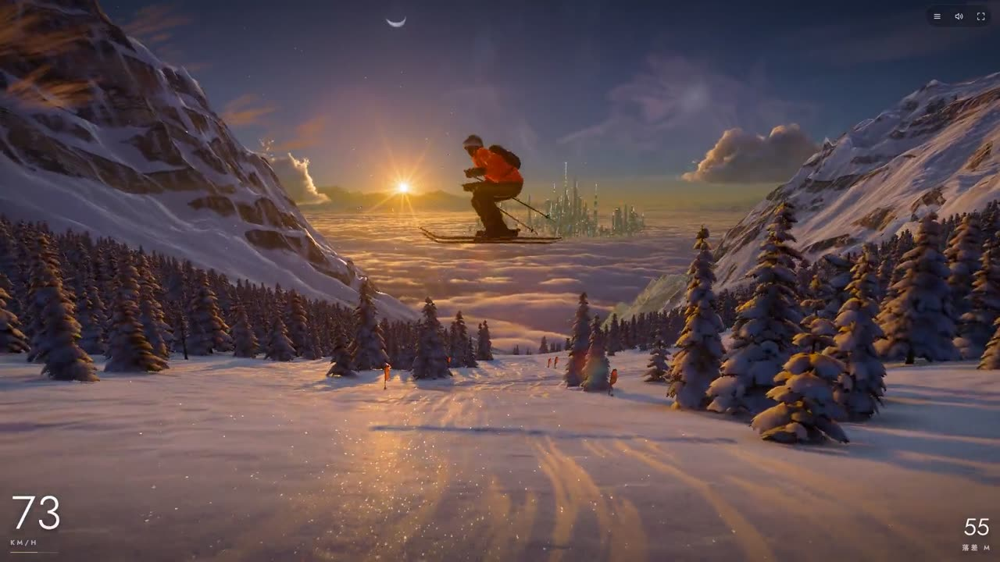
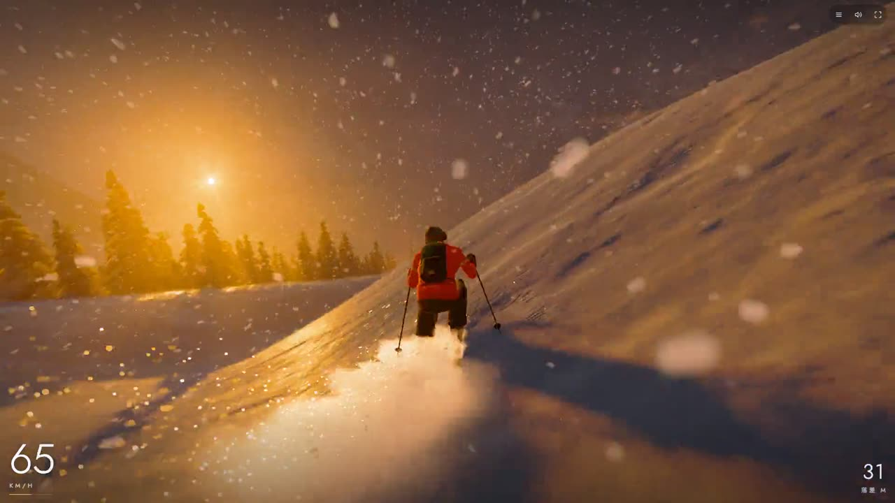
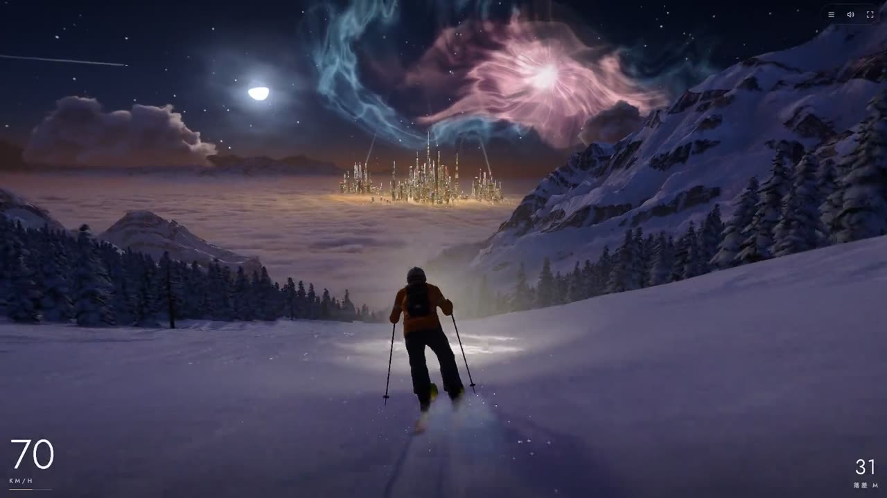

<div align="center">

# 雪迹 · Cold Smoke

**An endless, chill downhill ski game in one HTML file. Every picture and every sound is made by code.**

**一个人，一座山，一直往下滑。整个游戏是一个 HTML 文件，画面和声音全部由代码生成。**

[**▶ Play in your browser / 在线试玩**](https://huisky.xyz/cold-smoke/play) · [English](#english) · [中文](#中文)



</div>

---

## English

Cold Smoke is a calm, endless downhill run through a mountain that never repeats. There is no score to chase and nothing to unlock: you carve, jump, tuck, and watch the light change from morning to night.

What makes it unusual is what the repository **doesn't** contain:

- **No image, audio, model or texture files.** The mountain, snow, trees, sky, clouds, aurora, the skier and the animals, the music and the wind are all generated at runtime by about 18,000 lines of plain JavaScript and shaders.
- **One self-contained page, about 1.6 MB.** The build step just concatenates the source files into `dist/index.html`. No bundler, no framework, no npm dependencies. (The only thing fetched from the network is two web fonts for the title.)
- **WebGPU first, WebGL2 fallback.** Shaders are written once in a WGSL subset and translated to GLSL ES 3.00 for the fallback.
- **Made by talking to an AI.** The game was built with Claude (mostly Claude Fable 5.2) over a few days of play-and-feedback rounds: the author played, described what felt wrong, and Claude rewrote the code.

| | |
|---|---|
|  |  |
|  |  |

### Features

- An endless course built from a shuffled deck of run types: open bowls, steep pitches, woods, ridges, jumps and gates.
- A full day and night cycle with sun, moon, stars, nebula, aurora, a cloud sea and a far city, plus weather from clear skies to heavy snow. One real second is one minute on the mountain (a full day is 24 minutes, sunrise at 06:00 and sunset at 18:30), and the corner shows the time and the weather.
- Snow that reacts: carved tracks, powder plumes and spray lit by the sun, falling snow and wind.
- Synthesised sound and music that follow your speed, turns and time in the air.
- Several camera views, a photo mode, and English or Chinese UI picked from your browser.
- Every mountain grows from a seed: share the `#seed-…` in the address bar and a friend gets the same mountain.
- **Today's mountain** (今日之山): one mountain a day, the same for everyone, changing at midnight Beijing time. One tap on the title page or in the menu, or open the game with `#today`. Ski its first three stretches in one go from the top and your time is kept.
- A quality setting (auto, high, balanced, smooth) in Settings, so mid-range phones stay smooth.
- Keyboard and mouse on a computer; drag or tilt on a phone held in landscape.

### Controls

| Action | Keyboard | Phone | WebXR on Apple Vision Pro |
|---|---|---|---|
| Turn | ← → or A D | drag left / right (or tilt) | lean or tip your head left / right |
| Drive the edges in a turn (lower, tighter) | ↓ or S held while turning | drag the steering finger down | head back |
| Weight on the tips: the tails skid, you slow down | ↑ or W | drag the steering finger up | head forward |
| Jump (hold to load up) | Space | hold the Jump button, let go | hold a left-hand pinch, let go |
| Tuck for speed | Shift | hold the Tuck button | hold a right-hand pinch |
| Change camera | V (Shift+V back) | camera button above Jump | (chase camera only) |
| Menu / pause | Esc | corner button | Digital Crown leaves Immersive, the menu is waiting |
| Photo mode (everything frozen, free camera) | menu → Photo · drag to look, WASD / Q E to move, wheel to zoom, Enter to shoot, Esc back | menu → 拍照 · drag on the right to look, stick on the left to move, pinch to zoom, round button to shoot | |
| All controls | H | menu | |

In the Web version, the **Immersive** button on the title page only appears in a browser that can open a headset (Safari on Apple Vision Pro). See [docs/ARCHITECTURE.md](docs/ARCHITECTURE.md#immersive-mode-apple-vision-pro).

### Apple Vision Pro

Open `visionos/ColdSmokeVision.xcodeproj`, select **ColdSmokeVision** and run on Apple Vision Pro. The build draws the app icon with `node tools/generate-icons.js` before it compiles the asset catalog. Node.js 18 or newer needs to be on `PATH`. Choose **Immersive** and press **A** on the controller to start. You can look around freely while skiing. To steer by leaning and use pinch gestures, enable **Body controls** in the game window’s **Settings**.

Turn on **Preferences → Advanced → Show advanced options** to access scene controls and version comparisons. Under **Version comparison → New**, choose **Equipment → Snowboard** or enable **Ring challenge**. The headset remembers these choices.

An Xbox Series X|S Wireless Controller paired in visionOS Settings → Bluetooth works in the window and the immersive space. **Left stick:** steer and shift weight. **A:** start, then hold to load a jump and release to launch. **RT:** pole or tuck. **Y:** enter Immersive or recenter while inside. **Menu:** return to the paused window. Reenter to continue the same run.

During a run, **LB** selects the previous camera and **RB** selects the next. Press **X** once to freeze the scene. Move the camera with the left stick and frame the shot by looking around in Immersive or using the right stick in the window. Press **X** again to save a photo to Photos, or **B** to resume skiing.

### iPhone Duo

Open `ios/ColdSmoke.xcodeproj` with Xcode and the iOS 27.1 SDK or newer. Run the **ColdSmoke** scheme on an iPhone Duo simulator or signed device. The build bundles the local Web game and fonts for offline play. App icons and the jump and tuck symbols are drawn by `node tools/generate-icons.js` during that build and are not stored in the repo. Node.js 18 or newer needs to be on `PATH`.

WKWebView runs the shared simulation and audio. The iOS graphics adapter sends the shared scene to Metal, and UIKit presents the game buttons with Liquid Glass on iOS 26 and later. The camera follows the native window as the phone folds. While skiing, tap the camera icon on the right to frame a shot. The shutter captures the Metal scene, **Save** opens the system share sheet, and **Back** resumes the run.

The native pause menu keeps your selected page as the Duo opens or closes. Turn on **Preferences → Advanced → Show advanced options** to adjust time and weather, skip to terrain, arrange encounters, choose a mountain, or compare versions. The switch defaults to off and the Duo remembers your choice.

### Run it locally

You need [Node.js](https://nodejs.org) 18 or newer and a browser with WebGPU or WebGL2 (any recent Chrome, Edge, Safari or Firefox).

```bash
git clone https://github.com/huiskylabs/cold-smoke.git
cd cold-smoke
npm start            # = node build.js && node tools/serve.js
```

Then open <http://localhost:8080>. After editing anything in `src/` or `template.html`, run `node build.js` again and reload.

Useful URL parameters: `?backend=webgl2` (force the fallback renderer), `?lang=en` or `?lang=zh`.

Add `?dev` (or open a path ending in `/dev`; the local server serves that as the game) for developer mode: the time of day, the weather and its random-function settings, encounters, and the version comparison. None of that is in the menu otherwise. The Xiaohongshu build never opens developer mode.

### Project structure

```
src/            the whole game, one module per file, concatenated in name order
  01_gfx.js       rendering layer over WebGPU and WebGL2 (WGSL → GLSL translation)
  03_course.js    the endless mountain
  04_terrain.js   snow and rock        05_sky.js  sun, moon, time of day, aurora
  07_game.js      physics, pose and chase camera
  08_skier.js     the skier, built from distance fields at load
  10_spray.js     snow spray           18_sound.js / 18b_music.js  all audio, synthesised
  19_ui.js        loading page, title, HUD and menus
  ...
template.html   page markup and CSS; build.js puts the code into it
build.js        writes dist/index.html (fragment) and dist/dev.html (full page)
tools/          local server, Xiaohongshu mini-tool build, video frame renderer
director/       camera scripts for recording the trailer (?director=1)
xhs/            polyfills and fonts for the Xiaohongshu mini-tool package
test/           a standalone check of the rendering layer
docs/           architecture notes and the images in this README
```

How each part works, and the look and feel decisions behind it, are in [docs/ARCHITECTURE.md](docs/ARCHITECTURE.md).

### Make your own

If you want to make a game or animation like this with your own AI agent (all code, no assets), see the sibling project [code-only-game-kit](https://github.com/huiskylabs/code-only-game-kit), a skill that teaches an agent how to do it.

### Contributing

Bug reports, performance numbers from real devices and pull requests are welcome. See [CONTRIBUTING.md](CONTRIBUTING.md).

### License

[MIT](LICENSE). The fonts in `xhs/fonts/` (Jost, Cormorant Garamond, Noto Serif SC) are under the SIL Open Font License.

If you like it, a ⭐ helps other people find it.

---

## 中文

雪迹是一个安静的无尽滑雪游戏：一座永远不重复的山，从早滑到晚。没有分数要追，也没有东西要解锁，只管转弯、起跳、压低，看光线一点点变化。

它特别的地方在于仓库里**没有**的东西：

- **没有任何图片、音频、模型或贴图文件。** 雪山、雪、树、天空、云海、极光、滑雪的人和动物、配乐和风声，全部由大约 1.8 万行 JavaScript 和着色器在运行时生成。
- **一个独立的网页，约 1.6 MB。** 构建只是把源文件拼进 `dist/index.html`。没有打包工具，没有框架，没有 npm 依赖（唯一从网上下载的是标题用的两种字体）。
- **优先用 WebGPU，不支持时自动退回 WebGL2。** 着色器只写一遍（WGSL 子集），自动翻译成 GLSL ES 3.00。
- **是跟 AI 聊出来的。** 整个游戏用 Claude（主要是 Claude Fable 5.2）做的，花了几天，一轮一轮地玩、说哪里不对、让 Claude 改代码。

### 有什么

- 无尽的赛道：开阔大坡、陡坡、树林、山脊、跳台、旗门随机组合。
- 完整的昼夜：太阳、月亮、星空、星云、极光、云海和远处的城市，天气从晴天到大雪。现实中的一秒是山上的一分钟（一整天 24 分钟，日出约 06:00，日落约 18:30），右上角显示时间和天气。
- 会反应的雪：刻滑的雪痕、粉雪扬起的雪雾、逆光的雪花、飘雪和风。
- 合成的音效和配乐，跟着速度、转弯和滞空变化。
- 多个机位，菜单里能拍照，界面中英文按浏览器自动切换。
- 每座山由一个编号生成：把地址栏里的 `#seed-编号` 发给朋友，就是同一座山。
- **今日之山**：每天一座，所有人同一座，北京时间零点换。标题页或菜单里点一下就到，也可以在网址后面加 `#today`。从山顶一口气滑完前三段，会记下你的用时。
- 设置里可以选画质（自动、高、均衡、流畅），中端手机也能流畅地玩。
- 电脑用键盘鼠标；手机横屏用拖动或者倾斜。

### 操作

| 动作 | 键盘 | 手机 | Apple Vision Pro 网页沉浸模式 |
|---|---|---|---|
| 转弯 | ← → 或 A D | 左右拖动（或倾斜手机） | 头往左右歪或身体往左右挪 |
| 压刃（转弯时按住：更低、拐得更急） | 转弯时按住 ↓ 或 S | 转弯的手指往下拖 | 头往后 |
| 压板头（板尾甩出去搓雪减速） | ↑ 或 W | 转弯的手指往上拖 | 头往前 |
| 跳（按住蓄力） | 空格 | 按住「跳」，松开起跳 | 左手捏住，松开起跳 |
| 压低加速 | Shift | 按住「加速」 | 右手捏住 |
| 换机位 | V（Shift+V 往回） | 「跳」上方的机位按钮 | （只有追身机位） |
| 菜单 / 暂停 | Esc | 角上的按钮 | 按数码表冠退出沉浸模式，菜单在外面等着 |
| 拍照模式（一切定住，自由镜头） | 菜单 → 拍照 · 拖动鼠标转视角，WASD / Q E 移动，滚轮缩放，回车拍照，Esc 返回 | 菜单 → 拍照 · 右边拖动转视角，左边摇杆移动，双指缩放，圆按钮拍照 | |
| 全部操作 | H | 菜单 | |

Web 版标题页的「沉浸模式」按钮只在能打开头显的浏览器里出现（Apple Vision Pro 的 Safari）。

### 在 Apple Vision Pro 上运行

用 Xcode 打开 `visionos/ColdSmokeVision.xcodeproj`，选择 **ColdSmokeVision** 并在 Apple Vision Pro 上运行。构建会在编译素材目录之前用 `node tools/generate-icons.js` 画出应用图标，`PATH` 里需要 Node.js 18 或更新版本。点「沉浸模式」，按手柄 **A** 出发。滑行时可以自由转头环视。想用倾身转向和捏合起跳时，在游戏窗口的「设置」里打开「身体动作控制」。

打开「偏好设置 → 高级 → 显示高级选项」，即可调整场景或进入「版本对比」。在「版本对比 → 新加的」中，将「滑具」设为「单板」，或打开「光圈挑战」。头显会记住这些选择。

Xbox Series X|S 手柄可在头显的「设置 → 蓝牙」配对。左摇杆转向和调整重心，**A** 出发或蓄力起跳，**RT** 加速，**Y** 进入沉浸或在沉浸中重新校准正前方。按**菜单键**回到暂停窗口，再进入会从原处续滑。

滑行时，**LB** 切到上一个机位，**RB** 切到下一个。按一次 **X** 定格雪场，用左摇杆移动相机。沉浸模式里转头取景，窗口里用右摇杆取景。再按 **X** 拍摄并存入相册，按 **B** 从原处继续滑行。

### 在 iPhone Duo 上运行

用带 iOS 27.1 或更新 SDK 的 Xcode 打开 `ios/ColdSmoke.xcodeproj`，选择 **ColdSmoke** 和 Duo 模拟器或已签名的真机，点运行。Xcode 会将当前 `src/`、界面和字体打进应用，可离线游玩。应用图标和起跳、加速符号由构建时的 `node tools/generate-icons.js` 绘制，不放进仓库。`PATH` 里需要 Node.js 18 或更新版本。

WKWebView 运行与 Web 版共用的滑行逻辑和声音，Metal 绘制雪场，UIKit 提供原生 Liquid Glass 游戏按钮。折叠时相机按窗口尺寸更新。滑行时点右侧的相机图标取景，按快门拍下雪场。点「保存」打开系统分享面板，点「返回」继续滑行。

原生暂停菜单在展开与合上时保留当前页面。打开「偏好设置 → 高级 → 显示高级选项」，即可调整天色与天气、跳转路段、安排偶遇、选择雪山或对比版本。开关默认关闭，Duo 会记住你的选择。

### 在本地运行

需要 [Node.js](https://nodejs.org) 18 以上，和支持 WebGPU 或 WebGL2 的浏览器（最近版本的 Chrome、Edge、Safari、Firefox 都可以）。

```bash
git clone https://github.com/huiskylabs/cold-smoke.git
cd cold-smoke
npm start            # 等于 node build.js && node tools/serve.js
```

然后打开 <http://localhost:8080>。改了 `src/` 或 `template.html` 之后，再跑一次 `node build.js`，刷新页面即可。

常用参数：`?backend=webgl2`（强制用 WebGL2），`?lang=zh` 或 `?lang=en`。

加上 `?dev`（或者打开以 `/dev` 结尾的路径；本地服务器会把它当成游戏页面）进入开发模式：天色、天气和随机天气的参数、偶遇、版本对比。平常的菜单里没有这些。小红书的包不会打开开发模式。

### 小红书小工具

游戏也打包成了小红书的「小工具」（离线网页包）。`node tools/build-xhs.js` 生成 `dist-xhs.zip`，规则和细节见 [docs/ARCHITECTURE.md](docs/ARCHITECTURE.md) 里的「小红书 小工具 package」一节。

### 目录结构

见上面英文部分的 [Project structure](#project-structure)。每个模块怎么工作、画面为什么这样定，写在 [docs/ARCHITECTURE.md](docs/ARCHITECTURE.md)（英文）。

### 自己做一个

想用自己的 AI agent 做一个类似的纯代码游戏或动画（不用任何素材），可以看姊妹项目 [code-only-game-kit](https://github.com/huiskylabs/code-only-game-kit)，它是一个教 agent 怎么做的 skill。

### 参与

欢迎提 bug、贴真机帧率、提 PR，见 [CONTRIBUTING.md](CONTRIBUTING.md)。

### 许可

[MIT](LICENSE)。`xhs/fonts/` 里的字体（Jost、Cormorant Garamond、Noto Serif SC）使用 SIL Open Font License。

喜欢的话点个 ⭐，能让更多人看到。
